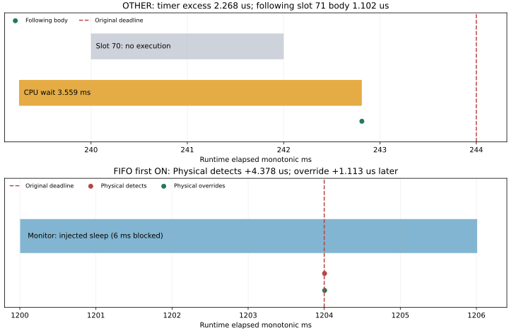

# Fixed campaign completed: 2026-10-20 21:34:25

**Collection VALID11/11; workloads20 PASS/2 FAIL; M4 NOT CLOSED.**
This is the separately planned follow-up after the
[212418 invalid attempt](../README.md#first-privileged-fixed-campaign-2026-10-20-212418).
The earlier CPU9 loss/2 workload failures/20 NOT RUN entries remain unchanged.

## Identity, protocol and complete denominator

Source `d3e7f6d3147a3e12a8c302c81e05af57795a0a29`;
fingerprint `2dfe69b3892f93b5665b05e740178e72190f9960ee89417c381b37ca6f7d87fa`;
unchanged actuator binary
`4736b40e8b5b2b67c4cf603ff96a7b1516d619541fdb10a8de80ff01b8f76347`.
Ubuntu22.04, kernel6.8.0-138-generic. All22 source/binary records remain stable.

User executed the [fixed sudo command](../../../../archive/m4-test-protocols.md#m4_kernel_capture) once:
OTHER loaded OFF→ON one pair, FIFO monitor-overrun OFF→ON ten pairs, normal
build,2540ms each, no retries/exclusions/warm-up removal. Collection took85.090s,
recorded1,222,462,910 bytes under the360s/3GiB limits. Analysis ran afterward as
the ordinary user. No agent build/test/tracer ran during the user's capture;
the collector's lock and conflict/cleanup checks also passed.

All22 runtime children: UID1000, effective capabilities0, RTPRIO20/20.
Root collector remained OTHER0/CPU2 with its own RTPRIO0/0. OTHER retained the
CPU1 OTHER0 load (7ms busy/10ms period); FIFO had no added load, as planned.
Actual owner placement/policy/priority and all setup/load/grid/growth/identity
controls passed. FIFO priorities are Front/Rear18, Steering/Brake/Drive/Power10,
BMS9, Central11, Physical19, Monitor20; Front/Rear/Physical/Monitor CPU0,
the others CPU1. No2ms opportunity/4ms deadline/20ms envelope change.

All11 ON traces:0 dropped/overrun/unknown lines, complete marker alignment,
all executed jobs linked to timer chains, instance removed/global settings
unchanged. Actual buffer allocation64560KiB remains below65536KiB. No EBADF.
This validates the new allocation in these11 windows, not unlimited capacity or
proof of the historical EBADF cause. [Buffer statistics](buffer-usage.csv).

| Condition | Runs | Runtime | Missed / skipped opportunities | Kernel evidence |
| --- | ---: | --- | --- | --- |
| OTHER loaded OFF | 1 | FAIL | 191 /191 | Tracing OFF |
| OTHER loaded ON | 1 | FAIL | 186 /186 | VALID;11924 executed chains |
| FIFO Monitor overrun OFF | 10 | 10 PASS | 4 /3 in each run | Tracing OFF |
| FIFO Monitor overrun ON | 10 | 10 PASS | 4 /3 in each run | 10 VALID;12107 chains each |

Both collector and offline analyzer return **exit1** because the two OTHER
workloads fail, not because collection is invalid. The prior exit2 is retained.
Every workload has12110 guard records. All FIFO misses target Monitor owner9
slots550–553 after the actual injection; **pre-injection deadline misses0/20
runs**. The late executed slot and three skipped slots are not silently filled.
The fault oracle passes because protection operates during the intended fault;
each runtime still reports `timing_ok=false`.
[All22 rows](workloads.csv), [full analysis](results.json), [command/exit](analysis-command.json).

## Delay location and protection

The first planned FIFO ON is selected by order, not fastest result. Runtime
origin458701139521700ns; Monitor TID1621144, Physical TID1621143, CPU0.
[Absolute/elapsed timeline](fifo-timeline.csv) and [job](fifo-injected-job.csv):

| Event | Elapsed ms |
| --- | ---: |
| Original Monitor slot550 release | 1200.000000 |
| Timer soft/hard expiry | 1200.000269 |
| Callback / wake / CPU switch | 1200.001300 /1200.002300 /1200.003300 |
| Body start and actual fault injection | 1200.004259 |
| **Original completion deadline** | **1204.000000** |
| Physical owner detects Monitor violation | 1204.004378 |
| Physical output override | 1204.005491 |
| Central observes gate closed | 1204.011976 |
| Front /Rear observed protection ACK | 1204.025994 /1204.207826 |
| Injected sleep returns /body ends | 1206.007476 /1206.009553 |

Front's next gate observation is1204.026061ms; these distinct events are
retained in [events](fifo-events.csv).
The injection diagnostic's `deadline_ns=1204.004259ms` is not the guard deadline:
all response measurements use the original slot's1204.000000ms deadline.

Timer excess1.031µs; wake→switch1µs. Body wall time6.005294ms decomposes into
6ms blocked by the explicitly injected `sleep_for`,1µs runnable off-CPU, and
4.294µs scheduled time (text precision1µs); thread CPU measurement4.178µs.
This is the intended sleep fault, not evidence of6ms unexpected scheduler delay.
Physical detects/overrides before Monitor resumes. No stopped-owner or physical
watchdog action is fabricated as a Leaf ACK. Living Leaf/Zone selections/ACKs
and Central observations are recorded separately.

Across all20 FIFO runs: deadline→detect **3.170–5.059µs**;
detect→override **1.008–3.484µs**. These are observed ranges, not new guarantees
or relaxed criteria. The global run gate and atomic protection requests are
same-process paths, not remote network isolation evidence. Normal operation
was armed before injection in all20 runs and stayed latched off after return.
No rejoin/recovery request was part of this cohort.

[Sampled physical response](fifo-model-response.csv): before injection torque60Nm,
brake0Pa, angle0.0539rad, HV about400V. At1212.008ms torque43.995Nm and pressure
40.012kPa; at1244.008ms torque0 and pressure200.014kPa. Contacts are open in the
1265.004ms sample and bus voltage then decays; steering holds0.0539rad. These
sampled rows retain their model source/sequence and separate Central observation
timestamp;1212.008ms is not the earliest gate-close or physical-override time.
This is model response, not a measured real vehicle stopping result.

OTHER repeats the previously observed CPU contention mechanism. First missed
Steering slot70 releases at240ms. Its following recorded service wake was requested
at239.200ms, before that release; it is not a fabricated timer for slot70.
Soft expiry239.200257, hard239.250257, callback/wake239.252525, CPU switch242.811525,
body242.811989–242.813091ms attributed to newer slot71. Slot70 remains unfinished
until deadline244ms; detection244.055556, override244.067640ms.
Timer excess2.268µs, CPU wait3.559ms, body1.102µs. The recorded load child
TID1621020 occupies3.536ms of that wait; IRQ union overlap6µs. Neither OTHER run
reached normal arm, so this is a readiness/execution failure.
[Timeline](other-timeline.csv), [CPU occupants](other-cpu-occupants-during-wait.csv).



## Reproduction and retained scope

All11 complete raw pairs stay at `build/m4-kernel-fixed-20261020-213425/`.
[Original SHA256 map](original-sha256.json) and offline verification confirm
every original file unchanged. [replay-data.tar.gz](replay-data.tar.gz) shares
all22 workload raw logs/CSV/JSON and all11 derived analyses, plus full kernel
traces for first OTHER ON and first FIFO ON. The other9 full kernel traces remain
local with hashes; they are deliberately not represented by the two shared traces.
No attempt or failure is excluded from summaries or the denominator.

```bash
# Full local raw replay, new destination; expected process exit1:
python3 tools/m4_kernel_campaign_analysis.py \
  build/m4-kernel-fixed-20261020-213425 build/m4-kernel-review-213425

# Shared results: extract to a new location; repeat the 22-row audit/plot:
mkdir -p build/m4-kernel-shared-213425
tar -xzf docs/test-plan/evidence/m4_kernel_campaign/completed_213425/replay-data.tar.gz \
  -C build/m4-kernel-shared-213425
python3 docs/test-plan/evidence/m4_kernel_campaign/completed_213425/reproduce.py \
  build/m4-kernel-shared-213425/m4-kernel-analysis-20261020-213425 \
  build/m4-kernel-shared-213425/audit
```

The shared audit uses the preserved all-pair analyses; it cannot independently
reparse the omitted9 kernel traces. Each of the two shared pair directories can
be copied to a new directory and passed to `tools/m4_kernel_analysis.py` for
independent full trace reconstruction. The OTHER detail was also regenerated
with `../m4_kernel_valid/reproduce.py` against the newly analyzed OTHER directory;
its CSV/report retain the exact wake even when it predates the missing release.
The new plot includes that earlier wake rather than clipping it.
Matplotlib is required for figures. [Execution checks](verification.json),
[audit log](audit.log), [Python112/112 PASS](python.log).

No runtime/concurrency/collector code changed in this analysis follow-up;
C++ full/ASan/TSan/native40/timing48 were **NOT RUN again**. Historical973 and
48-run acceptance data retain their original source. Kernel collection fixes
are validated for this cohort; **past FIFO execution-gap cause is still OPEN**
because it did not reproduce. Native CommandDelivery and DDS GC/lifetime warnings
also remain OPEN. No support-profile reduction, M4 closure or M5 adapter.
Target/system/learner states are unchanged. No further sudo collection is required
to analyze these saved results; a new hypothesis/protocol is needed before another
performance cohort.
