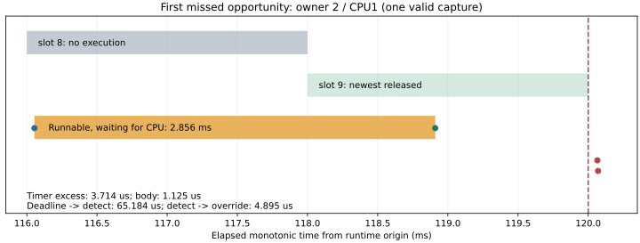

# M4 first valid OTHER kernel trace

**Capture VALID; runtime FAIL; M4 NOT CLOSED.** This identifies the delay location
for this Host/OTHER/load observation. It neither explains the historical FIFO
failure nor closes native/SDK TSan or Target/system acceptance.

Capture source: `0489ccc`, fingerprint
`e68b9ff1323bd24a9485b62a34e12bfef6bfb6301f20694f39ea4091f5b12e2e`.
Kernel6.8.0-138-generic, unchanged actuator binary SHA256
`4736b40e8b5b2b67c4cf603ff96a7b1516d619541fdb10a8de80ff01b8f76347`.
Actual UID/EUID1000/capabilities0, OTHER/0, Front/Rear/Physical/Monitor CPU0,
five Leaf and Central CPU1; original CPU1 7ms busy/10ms load,
2540ms duration,2ms guard opportunities/4ms completion deadline.

## All observed attempts

These are three user-launched attempts, not a prospective three-repeat
statistical cohort. No failed attempt was excluded.

| Output suffix | OFF misses | ON misses | Trace result |
| --- | ---: | ---: | --- |
| `185446` | 133 | 169 | End-marker EBADF; export incomplete |
| `185458` | 239 | 314 | End-marker EBADF; export incomplete |
| `185513` | 243 | 159 | **VALID**,729726 events,0 drops/unknown lines |

All six workloads FAIL with12110 guard rows each. Setup/load/grid/growth
controls pass. Global settings were unchanged and owned instances removed.
Earlier original/v1 failures remain in
[the previous evidence](../m4_kernel_capture_followup/README.md).
The valid trace links all11951 executed rows;159 opportunities were skipped.
Normal driving was never armed (`first_active_ns=0`), so these results establish
startup/readiness execution monitoring, not a successful normal-drive scenario.

## First missed opportunity, with one monotonic time axis

Runtime origin:449135277103007ns. Steering owner2/TID1561186, CPU1:

| Event | Runtime elapsed ms |
| --- | ---: |
| Slot8 release / requested wake | 116.000000 |
| Timer soft expiry | 116.000279 |
| Timer hard expiry (includes50µs slack) | 116.050279 |
| Callback and targeted wakeup | 116.053993 |
| Slot9 release | 118.000000 |
| Switch onto CPU | 118.909993 |
| Actual body, assigned to slot9 | 118.910534–118.911659 |
| Unfinished slot8 deadline | 120.000000 |
| Independent monitor detection | 120.065184 |
| Physical output override | 120.070079 |

`timeline.csv` retains the absolute timestamps; kernel text has1µs resolution.
Timer callback exceeds hard expiry by **3.714µs**; wake→CPU allocation is
**2.856ms**; actual body takes **1.125µs**. CPU1 is scheduled to Python TID1561182
for2.845ms of that wait, then briefly to other Leaf owners. Observed IRQ/vector/
softirq overlap in the wait is4µs (nested intervals unioned), not milliseconds.
This supports runnable CPU contention as the dominant observed delay in this
specific interval, not timer lateness or a long owner body.

TID1561182 is identified as the load child by its `sched_wakeup_new` parent
1561178 (recorded worker PID), creation before the vehicle child1561183,
runner spawn order and CPU1 OTHER behavior. `load.json` confirms that child's
configured workload but does not itself include a PID; the identity link is a
source/trace inference, not a PID field in that JSON. `worker-children.csv` and
`cpu-occupants-during-wait.csv` preserve the basis.

The failure does **not** require a single callback/body to take4ms:
[`M4ExecutionWatch::begin`](../../../../simulation/runtime/m4_execution_watch.cpp)
uses `newest_released`. At118.910534ms, slot9 has already been released, so
the body is attributed to9 and8 remains unfinished. The original monitor later
detects8 at its120ms deadline. It does not retroactively credit a later slot to
an earlier missed opportunity. This is the existing2ms opportunity/4ms completion
contract, not a new timeout or an assertion that the body began after120ms.
The five Leaf owners and Central all miss slot8 in this first group.

Deadline→detection is65.184µs, then detection→physical override4.895µs.
The override is the independent monitor/physical path, not a fabricated Leaf ACK.
The runtime summary's `first_fault_ns=127.469912ms` is later Central fault state;
it is not the earliest independent detection. The event CSV distinguishes them.
Whole-run maxima (different samples) are hard-expiry excess16.687µs,
wake→switch3.687ms and body25.050µs. They must not be combined into one event.



## End-marker EBADF and collector correction

Both new failing stacks pinpoint `stop_and_save → mark("end") → trace_marker`
write/flush, not the application or opening the application log.
[Linux tracing_mark_write](https://github.com/torvalds/linux/blob/v6.8/kernel/trace/trace.c#L7336)
can return EBADF if a ring event cannot be reserved. Thus EBADF alone does not
prove a closed userspace FD. The valid run's collector CPU2 ring contains244372
bytes in its small256KiB allocation. Marker-CPU saturation is a strong candidate;
the failed attempts lack their final statistics, so it is **not confirmed**.

`eecc1d7`:

- Preserves partial raw trace and stopped per-CPU statistics even if the end
  marker fails, then returns the failure. No marker is synthesized and missing
  clock alignment remains invalid.
- Records marker errno and pre-stop tracing state, and uses an unbuffered marker
  write to expose the original failure point.
- Gives the collector/marker CPU2MiB of headroom, keeping CPU0=16MiB, CPU1=32MiB,
  other CPUs=256KiB, total≤64MiB and text≤128MiB. On16 CPUs the nominal total is
  53.25MiB (actual tracefs rounded allocation is recorded). Application scheduling,
  load, clocks, periods and deadlines remain unchanged.

The two new failure/resource regressions fail on the old collector and pass
afterwards. Full Python suite **97/97 PASS** (previous95+2). Real tracefs execution
of this final error-preservation/headroom change is **NOT RUN**. Do not label the
earlier valid trace a test of that later change or claim EBADF eliminated.
No new C++/ASan/TSan/48-run cohort was run for this diagnostic-only change.

## Reproduction and retained files

`original-attempts.tar.gz` contains all three complete original directories,
including the729726-event trace and both failure stacks. `original-hashes.json`
and `SHA256SUMS` preserve identity. Derived report/CSV/graph generation is
read-only with respect to those inputs:

```bash
mkdir -p build/m4-kernel-valid-replay
tar -xzf docs/test-plan/evidence/m4_kernel_valid/original-attempts.tar.gz \
  -C build/m4-kernel-valid-replay
python3 docs/test-plan/evidence/m4_kernel_valid/reproduce.py \
  build/m4-kernel-valid-replay/m4-kernel-other-v2-20261020-185513/on \
  build/m4-kernel-valid-replay/derived
python3 -m unittest discover -s tests/unit -p '*_test.py' -v
```

The report script requires matplotlib for SVG/PNG. `validation.json` records
commands, analysis code identity and actual exit results. The graph was rendered
and visually checked. To rerun the complete analyzer, first copy the extracted
directory so its original analysis is retained; a VALID collection still has a
FAIL runtime verdict.

Next: retain this OTHER observation, confirm the marker error path on real
tracefs when collecting next, and prepare the original-user RT-limit boundary
before the unchanged FIFO condition. Sudo workers currently inherit0/0 rather
than the prior unprivileged20/20; FIFO is NOT RUN here. Historical FIFO/native/
SDK TSan OPEN items and M4 acceptance gates remain in force.
