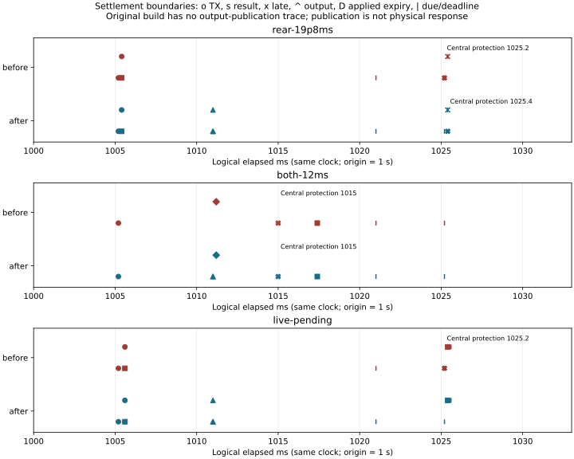
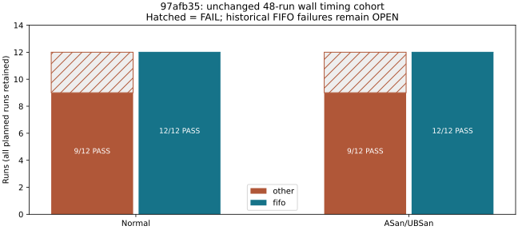

# M4 pending-command settlement evidence

Baseline:29b8221, clean worktree. Previous966-test/timing/native/SDK TSan evidence is
unchanged in [m4_contract_review](../m4_contract_review/README.md).
[ADR-0059](../../../archive/design-decisions.md#adr-0059) defines the
pending/expiry contract; [prospective protocol](../../../archive/m4-test-protocols.md#m4_settlement_protocol)
fixes the40 diagnostic and48 timing runs before execution.

## Reproduction before correction

`build/m4-settlement/before`:29b8221 production + two new tests. Focused4 tests:
existing12ms/19.8ms reproducers PASS, new live-pending and pending-admission tests
FAIL (CTest exit8). Original request/response/physical/event CSVs retained.
After initial correction the exclusive19.8ms case protects at1025.4ms instead of
the premature1025.2ms. Both12ms still protects for previous applied command expiry.

The first new all-normal assertion used persistent Front0.2ms/Rear19.6ms delays
and failed at1555ms Central observation (local Rear expiry1551.000001ms/service1551.2ms).
That wrong normal-capacity assumption is retained in `after-initial/`.
The positive regression now explicitly injects only1000–1020ms; a separate
sustained-delay regression requires expiry protection. No runtime deadline changed.
A subsequent draft build's missing braces triggered `-Werror=dangling-else`; the
test braces were corrected, with the failed build retained separately.

Diagnostic runner before-fix bookkeeping tests:1/8 PASS,5 assertion failures and
2 errors. Failed/timeout/warning trials could exit0; launch/parse errors aborted
remaining collection. The corrected eight tests run the real Python runner
process with a mocked workload and preserve actual exit codes. They are not
native workload/performance results.

## Final source and actual results

Implementation commits: `398a1de` (settlement/authority), `97afb35` (diagnostic
collection/exit status). All final C++/native/timing runs use **97afb35**,
source fingerprint `0ca80a921492576f270b5dfe00bd0bab0349447bf904be81ec1159d4a3e4a5c8`.
The Python71 run was immediately before the second commit with exactly that
fingerprint (`runner/metadata.json` records the dirty runner accurately).
Later documentation/analysis exports do not change this source fingerprint.
Ubuntu22.04, x86_64, kernel6.8.0-138-generic/PREEMPT_DYNAMIC, GCC11.4.0.
Exact environment, commands, process exits and binary hashes are in
[commands.json](commands.json) and [final metadata](final/metadata.json).

| Layer / actual execution | Result | Retained evidence |
| --- | --- | --- |
| Final focused C++ |55/55 PASS | `verified/`, full logs/raw in `development.tar.gz` |
| Whole Normal and ASan/UBSan | **973/973 each**,800 unit/164 logical/9 wall; durable CLI rejoin both PASS | `final/tests.csv`, `final/verification.tar.gz` |
| Baseline/name audit | Original948 + previous18 + new7; all966 baseline names retained | `final/verification-summary.json` |
| Python unit | **71/71 PASS**: existing63 + actual runner child-process8 | `runner/unit.txt`, `runner/mock-process-results.tar.gz` |
| Changed boundary TSan / actual wall | **108/108 +9/9 PASS**, warnings0 | `final/tsan-boundary.xml`, `final/tsan-wall.xml`; logs/raw in verification archive |
| Native diagnostic, trace ON, guards OFF | Normal20 + TSan20 = **40/40 PASS**, actual runner exit0 | `native40/summary.csv`, metadata/cohort/results and `raw.tar.gz` |
| Native timing, trace OFF, guards ON | **42 PASS /6 FAIL /0 BLOCKED**, FIFO24/24; controls48/48 | `timing48/cohort.json`, `final/timing-results.csv`, all48 raw in `timing48/raw.tar.gz` |
| clang-analyzer / cppcheck | Changed production4 files PASS, no diagnostic | `static/results.json` and logs |
| Requirement→implementation→actual test→criterion→result |93 component links | [component_results.csv](final/component_results.csv) |

The sole changed existing oracle is
`M4AsyncRuntime.PendingRearResultSelectsCommandDeliveryBeforeIndividualExpiry`:
the historical name is retained, but live pending no longer means failed
delivery. Exact exclusive envelope expiry must still protect. The12ms
applied-authority test is unchanged. Newly added test names and each build's
verdict are exported; no original test was dropped.

The diagnostic mock archive records all8 actual child-process exit codes:
all-pass0, individual failure/timeout/missing executable/missing CSV/skipped
GTest/malformed JSON/TSan warning1. Every mode retains40 planned records;
a failed launch is explicitly marked not executed. This is a bookkeeping test,
not40 native executions per mode. The separate native40 cohort contains actual
1.8s workload executions. Collection is not stopped after a failed trial.
The unchanged48-run timing collector returns0 when export completes; its
**42/6 oracle remains FAIL overall**, not a timing acceptance.

## Time and physical response

[ADR-0059's table](../../../archive/design-decisions.md#adr-0059)
places source, CAN creation/initial sent, Front/Rear receive/result, Leaf handling,
applied expiry, nominal next release and protection on the same logical clock.
[command-timeline.csv](command-timeline.csv) includes original absolute ns and
elapsed ms (origin1s); `contract/` rows are declared deadlines/release markers,
not observed events. Only the first instance of each stage/owner/token is in
the small CSV; complete traces remain in the archives.



- Rear19.8ms: before premature Central protection1025.2ms; after wait then
  exact deadline rejection1025.4ms. The response is still too late, not a normal PASS.
- Both12ms: previous Rear applied expiry1011.000001ms, local service1011.2ms;
  Central observes protection1015ms, then rejects Rear dispatch1017.4ms.
  The newer command expiry1031.000001ms cannot extend the older applied command.
- Transient Front0.2ms/Rear19.6ms (injection1000–1020ms): actual controller output
  published1011ms, Rear result1025.4ms before deadline1025.6ms; fresh-root
  allocation resumes. Next root1041ms keeps the nominal20ms grid.
- The initial persistent version fails from local Rear authority expiry
 1551.000001ms/service1551.2ms, Central observation1555ms. The sustained regression
 now expects protection. A21ms response delay still times out at original1025.4ms.
- A Stop intent at1020ms during the transient pending batch completes the
  existing terminal handoff and actual HV OFF; joined/new-Epoch recovery is
  included in both whole regressions and CLI verification.

`leaf-completed` is ingress handling; new opt-in `leaf-output-published` is the
controller output snapshot, with its original command identity. The before
build had no such publication trace. Physical owner application/model response
is separate: [physical-window.csv](physical-window.csv) has angle, pressure,
torque, bus, SOC, gate and model sequence. Full physical CSVs and normal,
fault/partial-write, Stop and rejoin traces are in the verification archive.
`final/logical-normal.csv`, `central-stop.csv`, `drive-stop.csv`,
`overflow-rejoin.csv` and their SVGs provide small representative results.
The original persistent and final transient inputs have the same delayed
transaction in the plotted window; their later injection duration differs.

## Wall timing and OPEN scope



All48 trials retain the original2.54s,2ms opportunities/4ms completion deadline,
1211 slots/owner, CPU0/1, OTHER/FIFO settings and specified7ms/10ms load.
Six OTHER loaded normal failures are preserved with first missed opportunity,
deadline, detection and physical override in [failures.csv](timing48/failures.csv).
All24 intentional faults pass, with deadline→detection0.003282–0.084379ms and
detection→physical override0.000936–0.986748ms. These are measured Host responses,
not logical timestamps or Target bounds.

The process-local global gate/atomic override can immediately block other owners;
this is not proof of equivalent remote network protection. No stopped Leaf ACK
is synthesized. Actual release/body/controller period statistics for every run
are in `final/owner-timing.csv` and per-run `owners.json`.

[Remaining analysis](open_analysis.md) separates the corrected pending defect
from the still-unconfirmed historical native TSan failure, retained FIFO misses
and DDS/Zenoh SDK warnings. Tracefs/perf captures, new instrumented SDK/Rust
cohorts, whole973 TSan, Target/Jetson generic-versus-PREEMPT_RT and whole-system
tests are **NOT RUN**. M4 **NOT CLOSED**, learner **REVIEW PENDING**; no M5 adapter.
No deadline, supported profile or existing exit condition was relaxed.

## Reproduce

Use fresh output directories (never overwrite a cohort). The archived
`commands.json` records the directories actually used. From repository root:

```bash
# Whole Normal/ASan, original names, fault/Stop/rejoin and representative export
python3 tests/integration/runtime/check_m4_faults.py \
  --raw-dir build/m4-settlement-repeat/full \
  --output build/m4-settlement-repeat/full-evidence

# TSan boundary; ASLR adjustment is per process only
cmake -S . -B build/m4-tsan -DCMAKE_BUILD_TYPE=Debug -DSTRATADRIVE_TSAN=ON
cmake --build build/m4-tsan -j4
STRATADRIVE_M4_RESULTS="$PWD/build/m4-settlement-repeat/tsan/raw" \
STRATADRIVE_M4_TRANSPORT_TRACE=1 setarch x86_64 -R ctest --test-dir build/m4-tsan \
  -R 'Remote|PeerFixture|AsyncZoneOwner|AsyncOwnerTest|M4AsyncRuntime|Coordinator|ControlAllocationTest.PendingPoll' \
  --output-on-failure --output-junit "$PWD/build/m4-settlement-repeat/tsan-boundary.xml"
STRATADRIVE_M4_RESULTS="$PWD/build/m4-settlement-repeat/tsan/wall" \
STRATADRIVE_M4_TRANSPORT_TRACE=1 setarch x86_64 -R ctest --test-dir build/m4-tsan \
  -L runtime.wall --output-on-failure \
  --output-junit "$PWD/build/m4-settlement-repeat/tsan-wall.xml"

# Process-exit/bookkeeping tests; fixtures are not native timing runs
STRATADRIVE_RUNNER_TEST_RESULTS="$PWD/build/m4-settlement-repeat/mock" \
  python3 -m unittest discover -s tests/unit -p '*_test.py' -v

# Finish builds/tests first; run these cohorts sequentially with no other workload.
python3 tests/integration/runtime/check_m4_delivery_trace.py \
  build/m4-settlement-repeat/native40
python3 tests/integration/runtime/check_m4_faults.py --reuse \
  --raw-dir build/m4-settlement-repeat/full \
  --output build/m4-settlement-repeat/complete-evidence --run-timing \
  --timing-dir build/m4-settlement-repeat/timing48
```

The timing cohort needs CPU0/1 and RT priority≤20; missing permissions/settings
are not PASS. Inspect CSV/JSON verdicts as well as process exits.
`summarize.py` reconstructs the small timeline/failure CSVs and SVGs from raw
directories; its docstring describes offline archive extraction. `SHA256SUMS`
covers this evidence tree. Historical artifacts in other directories are unchanged.
