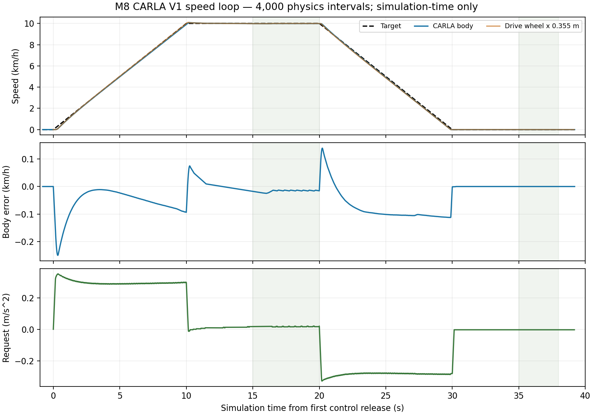

# M8 CARLA V1 저속 속도 폐루프

2026-10-29. **PASS: 고정 V1 simulation-time 속도 연결**.
Town03_Opt spawn0·MKZ2020·NoDrive320·single EV에서0→10→0km/h를 실행했다.
[사전 프로토콜](../../carla-speed-protocol.md), [ADR-0069](../../../archive/design-decisions.md#adr-0069),
[기계 판정](results-summary.json)을 따른다. 실제 CARLA 정상1회와 결함2회이며 반복성·다른 map/ODD 수용은 아니다.

## 결과

| 검사 | 원본 분모 | 결과 |
| --- | --- | --- |
| 정상 속도 폐루프 | 4,000개10ms physics interval·1,960회20ms 제어·3,919 normal intervals | PASS |
| 차체 속도 | 4,001개 관측; plateau500·정지300 | 최대 유지 오차0.024728km/h·overspeed1.425570%·정지0km/h |
| 제어 wheel 속도 | 1,960개 원천 관측; plateau250·정지150 | 최대 유지 오차0.018820km/h·overspeed1.072967%·정지0km/h |
| 원래 wire/solver/EV | 4,000개 work 정산 | PASS; 최대 energy balance 잔차2.94222e-8J |
| Snapshot 누락 | index200 주입·완료200구간·정산199개 | 다음 native/physics 실행 차단; 추가 tick 없음 |
| Solver work 누락 | index200 주입·완료200구간·정산199개 | native 거부·다음 physics 차단; work 합성 없음 |
| 서버 소유권·정리 | fresh server3개 | ego/settings 정리·SIGINT 종료130 모두 통과 |
| Normal 회귀 | unit/logical1,190개 | 모두 통과; 별도 SimpleVehicle 폐루프 nominal/Actual-loss/command-loss3개 통과 |
| ASan/UBSan | 영향 경계73개 | 모두 통과; SimpleVehicle3개도 통과 |
| Python/독립 판정 | unit219개·M8 speed 변조12개 | 모두 통과; 원래 solver11·EV7 변조 거부도 통과 |

Plateau는 제어 원점 기준[15,20)s, 정지는[35,38)s, 각 최대 오차 기준1km/h다.
Overspeed는 양수 목표에 대한 동시각 비율이며 기준10%다. Wheel은 원래 센서 시각,
body는 원래 physics 취득 시각에 대응한다. 시각 보간이나 음수 wheel의 절댓값 변환은 없다.



## 구현과 경계

V1의1696kg/0.355m를 명시적으로 사용하며 기본1000kg/0.3m는 유지한다.
`SpeedRequest::step_derived`는 검증된 current Drive Actual만 읽는다. 입력 누락·허가 상실·
새 원천 없는20ms release는 실패 latch이며 성공한0 가속도로 표시하지 않는다.
Request 생성 시각과 원래 sensor source를 분리하고, 현재 feedback/request30ms와
기존 PI model dependency60ms를 동시에 적용한다. Dependency는 기존 CommandContext
oldest/expiry로 전달된다. Wire ABI·서버 gate·PI 상수·ECU 주기는 변경하지 않았다.

초안 sensor-root30ms 매핑은 합성 stationary sensor/native admission 시험의 frame81에서
다음10ms 구간을 덮지 못했다. `validation/native-contracts.*`, `derived-native-contracts.*`,
`validation/phase-study.csv`, `development/phase{,.cpp}`에 초기 실패·진단을 보존한다.
Phase binary의202개 경우는 실제 CARLA 증거가 아니다. 요청/입력 시각 분리 후 기존
Controller 위상을 사용했으며 실제 CARLA 최초 실행 전에 protocol/source를 동결했다.
`pre-carla-source.tar.gz`와 최종438개 source의`final-sources.tar.gz`를 구분한다.
개발 중 test 기대값의 torque0.1Nm 양자화 수정 및 compiler 실패도 validation에 남긴다.

## 보관 및 재현

`nominal-01/`, `snapshot/`, `work-missing/`은 원본 gzip trace/result/events다.
대응`*-runtime/`은 실제 실행 binary/probe와 server/client log,
`server-*.json`은 실행 argv·source/binary hash·정리 결과다. 외부 UE/CARLA binary는
hash만 보관한다. 기록의 원래 build 경로와 보관 경로 매핑은`build-manifest.json`에 있다.
`*-speed-audit.json`, `*-work-audit.json`, `nominal-clock-audit.json`은 독립 판정이며
`speed-oracle-mutations-02.json`이 최종12개 변조 검사다. `SHA256SUMS`는 보관 파일 전체를 검증한다.

저장소 루트에서 빌드/경계 검사:

```sh
cmake -S . -B build/m8-carla-replay -DCMAKE_BUILD_TYPE=Release \
  -DSTRATADRIVE_M7_FUNCTIONAL_TESTS=ON -DSTRATADRIVE_LONGITUDINAL_EQUIVALENCE=ON
cmake --build build/m8-carla-replay -j 4
ctest --test-dir build/m8-carla-replay -L 'unit|integration.logical' --output-on-failure
```

실제 CARLA 재실행에는 기존 source server/venv/fixture가 필요하다. 다음 경로는 이 실행 환경의 값이다.
새 runtime/output 디렉터리만 사용한다. runner가2200–2202 포트의 비점유를 확인하고 자체 서버를 소유한다.

```sh
run_root="$PWD/build/m8-carla-replay-runs"
for case in nominal snapshot work-missing; do
  fault="$case"
  if [ "$case" = nominal ]; then fault=none; fi
  python3 tests/integration/carla/m7_1o_run.py \
    --engine /d/shin/stratadrive-tools/UnrealEngine_4.26 \
    --source /d/shin/stratadrive-tools/m7-source/carla-0.9.16 \
    --python /d/shin/stratadrive-tools/m7-source/m7-nodrive-venv/bin/python \
    --fixture /d/shin/stratadrive-tools/m7-source/m7-1m-fixture \
    --native-actual "$PWD/build/m8-carla-replay/tests/integration/carla/m7_1g/m7_wheel_shadow" \
    --runtime "$run_root/$case-runtime" --output "$run_root/$case" \
    --vehicle-substeps 320 --solver-work --held-steer-sleep \
    --simulation-continuous --speed-loop --ticks 4000 --native-fault "$fault" || break
  python3 tests/integration/carla/audit_m8_speed.py "$run_root/$case" \
    --case "$case" --output "$run_root/$case-speed-audit.json" || break
  python3 tests/integration/carla/audit_m7_1r_work.py "$run_root/$case" \
    --output "$run_root/$case-work-audit.json" || break
done
```

기존 보관 원본의 재판정은 새 output 파일로 실행한다:

```sh
python3 tests/integration/carla/check_m8_speed_corruptions.py \
  docs/test-plan/evidence/m8_carla_speed/nominal-01 --output /tmp/m8-speed-mutations.json
cd docs/test-plan/evidence/m8_carla_speed
sha256sum -c SHA256SUMS
```

## 남은 범위

Curvature0이며 경로·횡방향 제어·Reference30km/h 수용은 후속이다. 이번 정지 결과는 실제
wheel/body 정지와 hold이며 CARLA NormalStop HV-off를 검증한 것은 아니다. 두 결함 시험은
barrier containment이지 물리 차량 제동 완료 증거가 아니다.

벽시계30ms를 넘은 관측이1,169개였고 constant clock offset도 성립하지 않았다.
원래 simulation source를 사용한 기능 통과이며 wall 실시간 성공으로 바꾸지 않는다.
세 서버의 정상 종료도 과거 UE SIGSEGV·wall startup FAIL 원인 해결로 세지 않는다.
기존 `m8_speed_pi/`, `m8_speed_loop/`의 원본과 SHA256SUMS는 수정하지 않았다.
