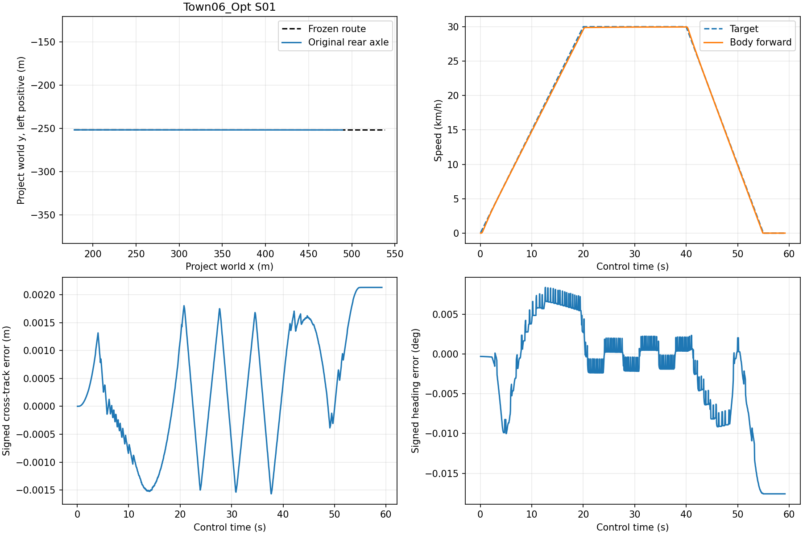
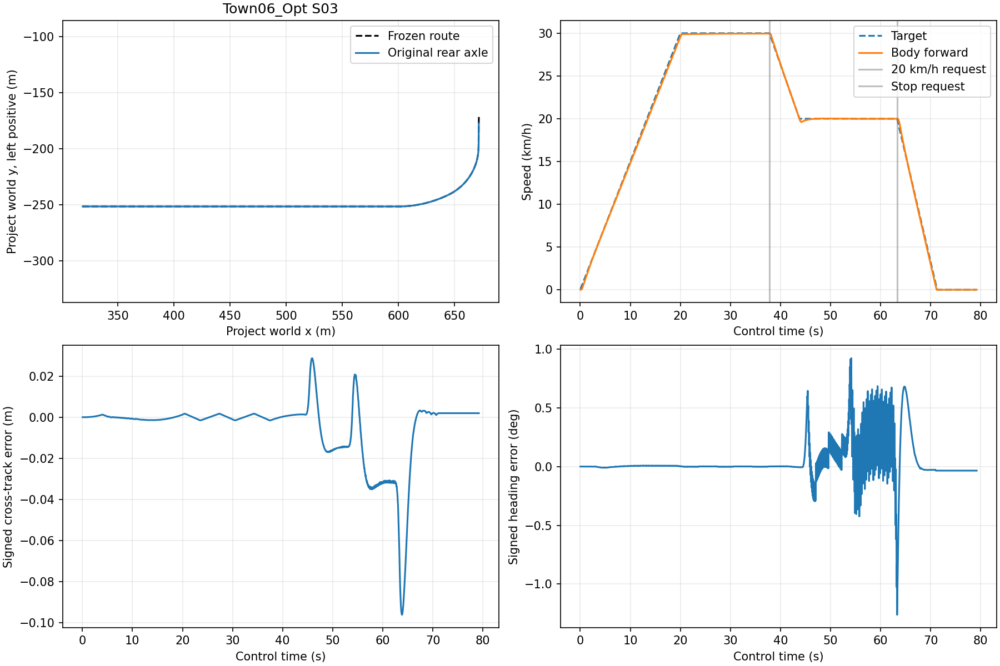

# M8 S01 직선·S03 복합 경로와 위치 기반 감속

2026-10-30. **S01 고정 직선과 S03 v2 고정 복합 경로의 simulation-time 시험 PASS**.
Town06_Opt·MKZ2020 V1·NoDrive320·원본 solver work·single EV 범위다.
기존 SpeedPI/Pure Pursuit/VehicleRequest→allocation→Zone→Leaf→Actual 경로를 유지한다.
ActorSnapshot localization과 경로·속도 생성기는 시험 fixture이며 전체 Reference/M8,
Planner/localization 구현, wall 실시간, CARLA NormalStop HV-off 수용이 아니다.

## 결과와 분모

| 항목 | S01 `S01-01` | S03 v2 `S03-02` |
|---|---:|---:|
| Physics / EV 정산 | 6000 / 6000 | 8000 / 8000 |
| 20ms 제어 / 정상 physics 구간 | 2960 / 5919 | 3960 / 7919 |
| 완료 marker / control 시간 | 300m / 48.708s | 395m / 66.668s |
| Active-route20Hz 표본 / 누락 | 974 / 0 | 1333 / 0 |
| 횡오차 P95 / Max | 0.001586 / 0.001803m | 0.034181 / 0.096147m |
| Heading P95 / Max | 0.008907 / 0.010008deg | 0.528511 / 1.260588deg |
| Body30km/h plateau 최대오차 | 0.074842km/h | 0.074868km/h |
| Body20km/h plateau 최대오차 | 해당 없음 | 0.028100km/h |
| Control-wheel30/20 plateau 최대오차 | 0.030900 / — km/h | 0.030900 / 0.039040km/h |
| Body 최대 positive-target overspeed | 1.414479% | 3.483824% |
| Control-wheel 최대 overspeed | 1.041442% | 2.482383% |
| Body / wheel 정지 최대오차 | 0.000001241 / 0 km/h | 0 / 0 km/h |
| 전체 추종 최대오차(body / wheel; 별도 보고) | 0.438814 / 0.433080km/h | 0.657746 / 0.475636km/h |
| Single EV 최대 balance 잔차 | 7.24103e-8J | 5.75528e-8J |

기준은 plateau/정지 오차≤1km/h, positive-target overspeed≤10%, active-route20Hz
횡오차 P95≤0.3m·heading P95≤3deg다. 각각10s plateau 전체100Hz body1000개,
50Hz control-wheel500개,20Hz body-state200개를 별도로 판정했다. 정지2s는200/100/40개다.
S03의 두 plateau는 각각 직선/곡선에 있어야 하며, 완료는 마지막 직선에서 확인한다.
20Hz body-state 판정도 모두 통과했고 상세 분모·최댓값은 각 `*-route-audit.json`에 있다.

S03 v2의230m 감속 요청은 control37.8s에 발생했다. 30→20km/h6s 전환 후
곡선 진입45.367999s의 body 속도는19.87454km/h다. 두 번째 plateau는[48.8,58.8)s.
380m 정지 요청은63.3s,20→0은8s이며 정지 평가는[73.3,75.3)s다.
Marker 시각은 원본 pose와 현재 control release에서 독립 재계산했으며 기록된 event를
정답으로 사용하지 않았다. 최종 rear-axle progress는 약402.13m로 고정 경로 끝408.11m 전이다.

두 정상 시험은 최종 wheel0·hold·마지막 work 정산·원래 settings 복원·actor 제거·
native exit0·소유 서버 SIGINT exit130을 완료했다. Simulation 시간 결과이며 실제 wall
실시간 보장은 아니다. 모든 실제 실행4개는 서버 exit130으로 종료했다.





그래프는 정지까지 전체 시간을 표시한다. 횡/heading P95는 protocol의 완료 marker까지다.

## 보존한 S03 v1 실패와 개정

`S03-01`은8000 physics·8000 정산·경로 완료·서버 정리를 마쳤지만 **제어 성능 FAIL**이다.
10s startup 뒤[15,25)s 첫 plateau에서 body 최대오차5.326104km/h,
wheel4.97676km/h였다. 두 번째20km/h plateau와 에너지 통과로 이를 상쇄하지 않는다.

1696kg×0.355m×(30/3.6/10s)=501.733Nm는 기존 propulsion300Nm 상한을 넘는다.
실제 독립 work 감사의 최대 구동 토크도300Nm다. `S03-v1-feasibility.json`은 이 제약과
원본 결과를 연결한다. 로컬 모델의 PI 계수나 구동 상한을 변경하지 않았다.

v2는 사전에 별도 schema/header/hash로 고정했다. S01에서 검증한20s startup
(관성 토크250.867Nm)과50m 더 긴 시작 직선, 첫 plateau[25,35)s,
감속230m·정지380m·완료395m를 사용한다. 감속6s/정지8s와 성능 기준은 유지한다.
v1 파일·binary·trace·판정은 그대로며 v1 평가 window를 사후 변경하지 않았다.
구동 가용력 기반 일반 reference 검증과 하위 actuator 포화 feedback/anti-windup은 OPEN이다.

`python-regression-01`의 독립 float 식 시험도 최초 실패를 보존한다. 정확한 bit equality를
잘못 요구해 약3e-15 차이를 실패로 판정했으며 approximate assertion으로 수정했다.
제어 코드나 실제 감사 tolerance는 이 수정으로 바꾸지 않았다.

## 결함·독립 감사·회귀

- `pose-stale`: S03 v2와 같은 binary. observation200의 pose source만10ms 과거로
  바꿔 original frame/source join에서 거절했다.200 physics·199 EV 정산 뒤 다음
  advance가 없었고 서버 exit130이다. 마지막1구간은 미정산이며 실제 제동 완료가 아니다.
- `audit_m8_route.py`는 pose/wheel source,20ms release,request/input expiry,
  독립 Pure Pursuit·위치 event·target·원본20Hz 경로와 body/wheel 성능을 검사한다.
- `audit_m7_1r_work.py`는 별도 wire/native admission·solver equation·원본 work·
  single EV 정산을 검사한다. 각 실행에서 solver11개와 energy7개 손상을 거절했다.
- Route 증거 변조는 S01 20개, S03 v2 28개를 거절했다. S03에는 요청 누락·과거/미래
  이동·조기 발생·원래30km/h 요청 유지·순간 target20 전환을 포함한다.
- 최종 C++ unit/논리1207/1207, ASan/UBSan 대상67/67, Python230/230,
  경로 header/horizon CLI12/12. 기존 S02 원본도 확장 oracle로 다시 PASS였다.
- 이전 M8 증거683개 hash 일치: PI103, SimpleVehicle242, 저속 CARLA145, 곡선193.
  Python 모델 SHA256은 `181297fb101d0f7dc69222489956a3bdcc701924556fa2210e4ff5705975e858` 그대로다.

## 원본과 재현

`results-summary.json`은 정상2개·결함·실패v1을 구분한다. `runtime-*/probe/`는 실행 당시
binary/scripts/config, `server-*.json`은 실제 실행 artifact hash와 lifecycle을 보존한다.
S01/v1 binary는 `2a52b09929148f5b82ad5c741b25b9344b829690b820eb4a5f515dd4da3ad828`,
v2/결함 binary는 `ef3374830db925211e556c53acdcf341e410b68d6ba343545ca54c6d89357689`다.
두 버전을 같은 실행으로 합치지 않는다. 마지막 C++ 들여쓰기 정리 후 재빌드에서도 v2 binary
hash가 동일함을 `formatting-binary-identity.json`으로 확인했다.

`source-attempt01.tar.gz`는 첫 실행 전 source, attempt02는 같은 runtime source에 독립
감사·시험을 추가한 snapshot, attempt03은 v2 실행 전 source다. `source-final.tar.gz`는
최종 코드·문서다. Evidence 디렉터리 자체는 source archive에서 제외한다.
`configuration.json`에 원래 Git HEAD/compiler/build 옵션을 기록했으며 미커밋 작업 트리의
archive가 이번 source 기준이다. `SHA256SUMS`는 자기 자신을 제외한 모든 보존 파일을 검증한다.

[사전 protocol·v2 개정](../../carla-reference-protocol.md),
[component 계약](../../../interfaces/lateral-route-controller.md)을 따른다.
현재 로컬 UE/CARLA/SDK를 사용하고 runtime/output은 새 경로로 지정한다.

```sh
cmake -S . -B build/m8-reference-replay -DCMAKE_BUILD_TYPE=Release \
  -DSTRATADRIVE_M7_CONTRACT_TESTS=ON -DSTRATADRIVE_M7_FUNCTIONAL_TESTS=ON \
  -DSTRATADRIVE_LONGITUDINAL_EQUIVALENCE=ON
cmake --build build/m8-reference-replay -j 6
ctest --test-dir build/m8-reference-replay -L 'unit|integration.logical' --output-on-failure
python3 tests/integration/carla/m7_1o_run.py \
  --engine /d/shin/stratadrive-tools/UnrealEngine_4.26 \
  --source /d/shin/stratadrive-tools/m7-source/carla-0.9.16 \
  --python /d/shin/stratadrive-tools/m7-source/m7-nodrive-venv/bin/python \
  --fixture /d/shin/stratadrive-tools/m7-source/m7-1m-fixture \
  --native-actual build/m8-reference-replay/tests/integration/carla/m7_1g/m7_wheel_shadow \
  --runtime build/m8-reference-replay/runtime --output build/m8-reference-replay/S03 \
  --vehicle-substeps 320 --solver-work --held-steer-sleep --simulation-continuous \
  --route-profile tests/integration/carla/scenarios/m8_combined_v2.json \
  --route-startup-seconds 600 --ticks 8000
python3 tests/integration/carla/audit_m8_route.py build/m8-reference-replay/S03 \
  --case nominal --output build/m8-reference-replay/route-audit.json
python3 tests/integration/carla/audit_m7_1r_work.py build/m8-reference-replay/S03 \
  --output build/m8-reference-replay/work-audit.json
```

S01은 `m8_straight30_v1.json`/`--ticks 6000`, 실패 재현은 `m8_combined_v1.json`/8000이다.
결함은 새 runtime/output에 `--native-fault pose-stale`, route audit에는 `--case pose-stale`을 쓴다.
보존 원본의 재판정 output은 새 경로에 둔다.

```sh
python3 tests/integration/carla/check_m8_route_corruptions.py \
  docs/test-plan/evidence/m8_reference/S03-02 --output /tmp/m8-reference-mutations.json
cd docs/test-plan/evidence/m8_reference
sha256sum -c SHA256SUMS
```

다음 작업은 가용력 기반 참조·하위 구동 포화 처리, 주행 중 fault와 CARLA NormalStop 실제 응답이다.
전체 Reference/Planner/localization·ODD·wall/Target 수용과 UE renderer 근본 원인은 남아 있다.
