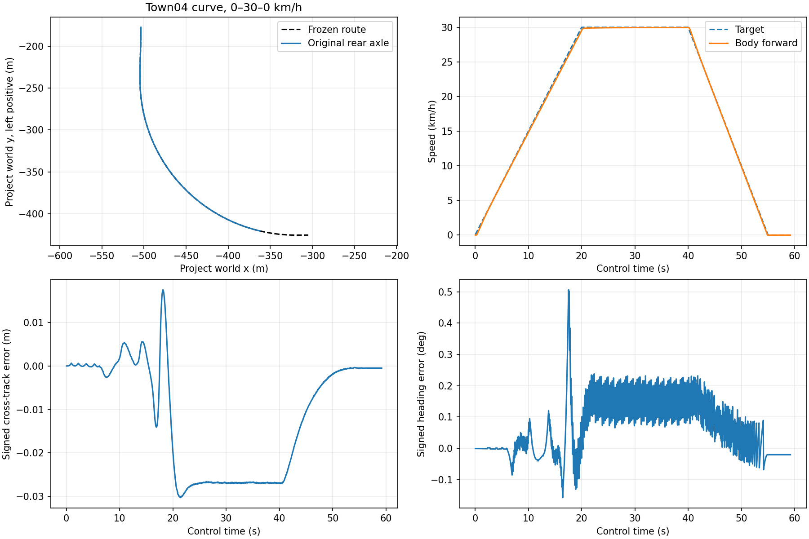

# M8 고정 곡선 30km/h 연결

2026-10-29. **최종 단일 곡선 기능 시험 PASS**. C++ Pure Pursuit와 기존 SpeedPI를
VehicleRequest→allocation→Steering/Drive/Brake owner→Actual→NoDrive에 연결했다.
Town04_Opt·MKZ2020 V1·vehicle320·원래 solver work·single EV·simulation time 범위다.
고정 경로와 ActorSnapshot rear-axle pose는 Planner/localization **fixture**이며 전체
S01–S03·M8·wall 실시간·CARLA NormalStop HV-off 수용이 아니다.

## 최종 결과

`curve30-03`은 단일 session6000×10ms physics,2960 controls,6000 work settlements,
5919 normal intervals다.0→30→0km/h,300m marker48.707999s,최종 wheel 정지·hold를
완료했다. 원래 settings 복원·actor 제거·native exit0·소유 서버 SIGINT exit130을 확인했다.

| 독립 지표 | 실측 | 기준/분모 |
| --- | --- | --- |
| 횡오차 P95 / Max | 0.027832 / 0.030250m | P95≤0.3m; active-route20Hz974개, 누락0 |
| Heading P95 / Max | 0.218502 / 0.506399deg | P95≤3deg; 동일974개 |
| 차체 plateau 최대오차 | 0.055025km/h | ≤1km/h; [25,35)s100Hz1000개 |
| Baseline20Hz plateau 최대오차 | 0.053917km/h | ≤1km/h; 곡선200개 |
| Control-wheel plateau 최대오차 | 0.018120km/h | ≤1km/h; 원본 source50Hz500개 |
| 양수 목표 최대 overspeed | 차체1.421350%, wheel1.041442% | ≤10%; 출발·감속 포함 |
| 정지 최대오차 | 차체0.000001322km/h, wheel0 | [57,59)s200/100개 |
| Ramp 최대 절대오차 | 차체0.450305, wheel0.433080km/h | 별도 보고, plateau와 혼합하지 않음 |
| Single EV 최대 balance 잔차 | 7.2236e-8J | 기존0.00072J;6000구간 독립 감사 |



`pose-stale-02`는 같은 최종 binary에서200번째 observation의 pose source를10ms 과거로
바꿨다. frame/source join이 거절되어200 physics·199 settlements 뒤 다음 tick이 없었다.
정리와 서버 exit130도 통과했다. 실제 차량 제동 완료를 뜻하지 않는다.

`curve30-03-route-audit.json`, `curve30-03-work-audit.json`은 원본과 독립적으로
경로·속도·pose/command lineage·wire admission·solver equation·work·EV를 검사했다.
Route 감사는20개 변조, 기존 work 감사는11개 solver/7개 energy 변조를 거절했다.
`results-summary.json`에 최종 실행과 과거 실패를 구분해 기록했다.

## 실패와 수정

- `curve30-01`: 새 Town04 shader/texture/mesh 생성이180s readiness 제한 초과.
  차량 생성 전 실패. SIGINT30s 안에 종료하지 않아SIGKILL−9. 후속의 route 전용
  준비 예산600s는 주행·RPC·source·종료 제한과 별개다.
- `curve30-02`:6000구간 주행 완료 후 settings 복원 중 UE renderer의
  `FDistanceFieldVolumeTexture::IsValidDistanceFieldVolume`/GPUScene SIGSEGV−11.
  전체 FAIL. 이후 같은 엔진의 정상 종료를 근본 원인 해결로 세지 않는다.
- 같은 실행의 구간 work 감사는 observation2102에서1.3234e-11J 차이로 기존1e-11J
  경계를 넘었다. 큰 누적 ledger를 차분하는 audit의 정밀도 손실이다.
  `work-audit-precision-diagnostic.json`과150kJ 재현 실패 시험을 보존했다.
  coupled observed-work audit가 **이미 EV에 전달한 solver 구간 적분량**을 직접 기록하도록
  수정했다. EV state·누적 work·성능 기준·감사 tolerance는 바꾸지 않았다.
- `pose-stale-01`: 수정 전 binary에서도 결함 차단·정리·독립 감사 PASS. 최종 binary의
  `pose-stale-02`로 다시 확인했으며 두 결과를 같은 실행으로 합치지 않는다.
- 충돌 후 port TIME_WAIT 때문에 한 번의 launch가 거절됐다. `NOT_RUN`으로 기록했고
  다른 프로세스/port를 변경하지 않았다. 빌드·테스트 초기 실패도 validation에 남긴다.

## 검증과 보존

- C++ unit/논리 통합1203/1203; ASan/UBSan 대상63/63.
- Python unit223/223와 최종 route oracle4/4.
- 이전 M8 evidence490개 hash 일치: PI103, SimpleVehicle242, 저속 CARLA145.
- Python longitudinal 모델 hash는
  `181297fb101d0f7dc69222489956a3bdcc701924556fa2210e4ff5705975e858` 그대로다.
- `source-attempt01/02/03.tar.gz`, `source-final.tar.gz`, 각 manifest, 실행 당시
  `runtime-*/probe/` binary/scripts/config와 server artifact hashes를 보존한다.
  Attempt02 archive는 실행 source 외에 실행 중 추가한 독립 감사/시험도 포함하며,
  실제 실행 파일은 runner snapshot/hash가 기준이다. 최종 binary는 attempt03 manifest를 따른다.
- `curve30-02/frozen-route.json`은 실행 당시 runner snapshot에서 복사한 동일 파일이다.
  후속 probe는 이를 자동 저장한다. 원본 trace/result/server report는 수정하지 않았다.
- `configuration.json`은 compiler/CMake/Python/build 설정과 원래 Git HEAD를 기록한다.
  작업 트리의 미커밋 source가 archive 기준이며 HEAD만으로 이번 변경을 재현할 수 없다.
- `SHA256SUMS`는 이 디렉터리의 모든 보존 파일(자기 자신 제외)을 검증한다.

## 재현

[사전 protocol 및 변경 이력](../../carla-route-protocol.md),
[component 계약](../../../interfaces/lateral-route-controller.md)을 먼저 따른다.
현재 로컬 CARLA/UE/SDK와 GTest가 설치된 환경에서 새 output 경로를 사용한다.

```sh
cmake -S . -B build/m8-route-replay -DCMAKE_BUILD_TYPE=Release \
  -DSTRATADRIVE_M7_CONTRACT_TESTS=ON -DSTRATADRIVE_M7_FUNCTIONAL_TESTS=ON \
  -DSTRATADRIVE_LONGITUDINAL_EQUIVALENCE=ON
cmake --build build/m8-route-replay -j 6
ctest --test-dir build/m8-route-replay -L 'unit|integration.logical' --output-on-failure

python3 tests/integration/carla/m7_1o_run.py \
  --engine /d/shin/stratadrive-tools/UnrealEngine_4.26 \
  --source /d/shin/stratadrive-tools/m7-source/carla-0.9.16 \
  --python /d/shin/stratadrive-tools/m7-source/m7-nodrive-venv/bin/python \
  --fixture /d/shin/stratadrive-tools/m7-source/m7-1m-fixture \
  --native-actual build/m8-route-replay/tests/integration/carla/m7_1g/m7_wheel_shadow \
  --runtime build/m8-route-replay/runtime --output build/m8-route-replay/nominal \
  --vehicle-substeps 320 --solver-work --held-steer-sleep --simulation-continuous \
  --route-profile tests/integration/carla/scenarios/m8_curve30_v1.json \
  --route-startup-seconds 600 --ticks 6000
python3 tests/integration/carla/audit_m8_route.py build/m8-route-replay/nominal \
  --case nominal --output build/m8-route-replay/route-audit.json
python3 tests/integration/carla/audit_m7_1r_work.py build/m8-route-replay/nominal \
  --output build/m8-route-replay/work-audit.json
```

결함 재현은 새 runtime/output에서 `--native-fault pose-stale`, route 감사의
`--case pose-stale`을 사용한다. 기존 evidence의 재판정 output은 새 경로에 둔다.

```sh
python3 tests/integration/carla/check_m8_route_corruptions.py \
  docs/test-plan/evidence/m8_route/curve30-03 --output /tmp/m8-route-mutations.json
cd docs/test-plan/evidence/m8_route
sha256sum -c SHA256SUMS
```

다음 단계는 S01 직선, S03 직선–곡선–직선 및30→20km/h 전환이다.
실제 localization/Planner, 전체 ODD·fault·wall 성능, CARLA NormalStop HV-off와
UE renderer 안정성은 남아 있다.
